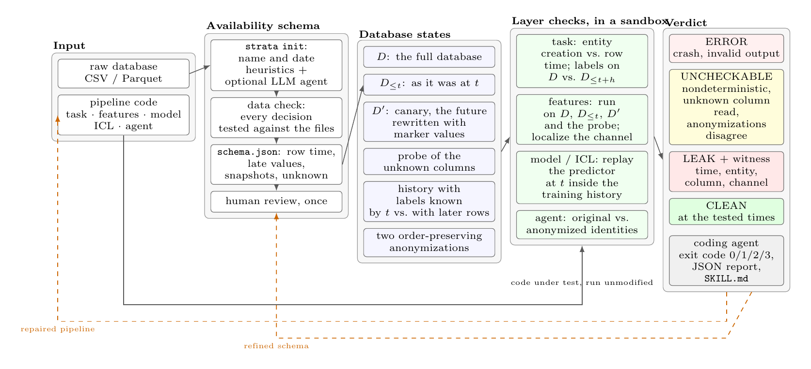

# STRATA

Layer-by-layer point-in-time checking of ML pipelines written by coding agents.

[**Demo**](https://jrzkaminski-strata-demo.static.hf.space) · [**Video (3 min)**](https://youtu.be/0cuCZMwuiCI) · [**Paper**](STRATA-ICSE2027-demo.pdf) · ICSE 2027 Tool Demonstration · MIT license

A pipeline over time-stamped relational data is point-in-time correct at a
prediction time `t` when its output on the full database equals its output on
the database as it was at `t`. STRATA runs every layer of a pipeline both ways
and compares the outputs. It never reads the code under test, so it works on
any pipeline a coding agent writes, on any database it has a schema for.

<p align="center"></p>

## What it checks

| Layer | What can go wrong | Command |
|---|---|---|
| task | rows for entities that do not exist yet at `t`; labels used before they are complete | `strata check task` |
| features | rows created after `t`; dates filled in later; values overwritten at the end of the data | `strata check features` |
| model | training rows whose outcome was unknown at `t` | `strata check model` |
| in-context | few-shot examples for an LLM taken from after `t` | `strata check icl` |
| agent | a model that knows an entity from outside the data | `strata check agent` |

Every check ends in one of four verdicts, with an exit code a script or an agent can act on:

| Verdict | Exit | Meaning |
|---|---|---|
| `CLEAN` | 0 | no difference at the tested times and entities |
| `LEAK` | 1 | a difference, with a witness: time, entity, column, channel |
| `UNCHECKABLE` | 2 | the output depends on a column whose availability is unknown, the program is nondeterministic, or the two anonymizations disagree |
| `ERROR` | 3 | the program crashed in the sandbox or returned the wrong shape |

## Install and run

```bash
pip install -e .                      # pandas, numpy; pyarrow for parquet
strata init --data path/to/csvs --out schema.json
strata check features --schema schema.json --program feats.py:get_features --entity product
python -m pytest tests                # 38 tests over a synthetic database
```

`strata init` drafts the availability schema from the raw CSV or Parquet files:
for each table, when a row appears and which values arrive later. With
`--llm` a language model proposes each decision with a reason, STRATA checks
every decision against the data, and the open questions are listed for the
person who knows the data. The model is called through OpenRouter
(`OPENROUTER_API_KEY`); it never produces a verdict or code. Review the draft
once; the checks run on the reviewed file. The format is documented in
`strata/schema.py`, an example is `examples/olist/schema.json`.

Contracts for the code under test: `get_features(tables, entity_ids, t)`
returns a DataFrame indexed by entity; `label(tables, entity_ids, t)` returns a
Series; a training script is run with the placeholders `{task_dir}`, `{split}`
and `{out}`. Code under test runs in a child process with a timeout, a memory
limit and an environment stripped of API keys.

## For coding agents

`SKILL.md` is the instruction file for a coding agent: which check to call for
which layer, how to read a witness, that only a rerun may declare a leak fixed,
and that `CLEAN` is scoped to the tested times. Drop it into the agent's skills
and it runs the check before reporting a score.

## Demo

The [demo](https://jrzkaminski-strata-demo.static.hf.space) is a browser
workbench over recorded STRATA runs on real data: a feature program written by
a code model for Olist gets `LEAK`, is repaired and rerun `CLEAN`; a program
that reads an overwritten status gets `UNCHECKABLE`; an agent-written RelBench
training script leaks in the model check. The live page runs STRATA itself in
the browser (Pyodide) on a sample of Olist: a model of your choice writes the
program or drafts the schema from an editable prompt, and the checks run on
the result.

To run the pages locally, serve the repository root and open `demo/about.html`:

```bash
python3 -m http.server 8000
# http://127.0.0.1:8000/demo/about.html
```

## Results

| Experiment | Outcome |
|---|---|
| PITBench, 8 databases, 34 control programs | 34 of 34 verdicts as expected |
| 98 hand-labelled changes to the reference pipelines | 43 of 43 leaking changes caught, 0 of 55 harmless flagged |
| The usual shortcut, cutting rows at `t` | 11 of 25 leaking programs found; with late dates and a canary, 16 of 25 |
| Olist, 134 feature programs written by code models | 62 of 63 oracle leaks confirmed, 16 leaks the oracle had passed |
| RelBench, 27 training scripts written by a coding agent | all 27 learn from rows after `t` |
| Schema drafting on the 8 databases | snapshot columns caught: rules 5 of 50, LLM agent 50 of 50 |

## Layout

| Path | Contents |
|---|---|
| `strata/` | the package: schema and temporal database, layer checks, verdicts, sandbox, CLI, schema drafting |
| `tests/` | tests over a synthetic database |
| `examples/` | schemas and replay scripts for Olist, PITBench and RelBench |
| `demo/` | the project page, the workbench, the live page and the Space build script |
| `paper/` | LaTeX sources of the ICSE 2027 demo paper |
| `SKILL.md` | instruction file for coding agents |

## Paper

Pavel Marian, Stanislav Chumakov, Danil Ezhov, Alexander Boukhanovsky.
STRATA: Layer-by-Layer Point-in-Time Checking of ML Pipelines Written by
Coding Agents. ICSE 2027 Tool Demonstration and Data Showcase.
[PDF](STRATA-ICSE2027-demo.pdf).

```bibtex
@inproceedings{strata2027,
  author    = {Marian, Pavel and Chumakov, Stanislav and Ezhov, Danil and Boukhanovsky, Alexander},
  title     = {{STRATA}: Layer-by-Layer Point-in-Time Checking of {ML} Pipelines Written by Coding Agents},
  booktitle = {Proc. 49th IEEE/ACM Int. Conf. on Software Engineering (ICSE), Tool Demonstration and Data Showcase},
  year      = {2027}
}
```
